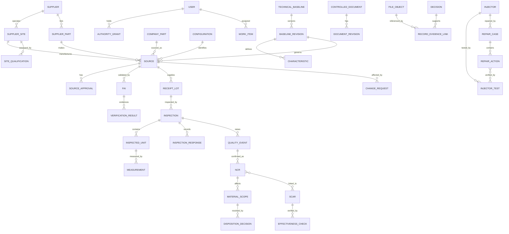

# Construction Drawing A — System, data, states and nonnegotiable invariants

## A1. Structural drawing / runtime bill of materials

**One coherent modular monolith**: React responsive application + Node.js maintained LTS backend in TypeScript; one PostgreSQL database as source of truth; one private Render disk for original and rendered evidence; database-backed outbox/job table; one Render web service at launch. Use supported, boring dependencies. Share strictly validated contract schemas. No AWS, S3, Redis, separate workflow engine, Kubernetes, microservices, event bus, separate search cluster, costly OCR/AI service, managed SaaS document vault, or special authentication infrastructure as a default dependency.

Development architecture is free to choose specific mature libraries but must document choices. Do not store photos/PDF bytes in PostgreSQL. Files reside on the persistent mount and are addressed only by controlled metadata + opaque IDs; the service returns authenticated, time-limited access using an authorization check. Database rows and disk objects MUST remain jointly recoverable through coordinated application-level backup and validation; PostgreSQL backup alone does not include evidence disk. Do not use container ephemeral storage as fallback. Run one instance when relying on one attached private disk; planned scale beyond it needs separately reviewed object-store migration.

### Module boundaries

- Identity, grants, scoped authority, segregation and sessions.
- Master data: suppliers, sites, parts, supplier parts, configurations and effective sources.
- Technical baseline/document control: requirements, characteristics, methods, revisions, changes and controlled forms.
- Sourcing, supplier/site qualification, supplier acknowledgments and commitments.
- FAI/validation and exact product-source authorization.
- Multi-unit receiving inspection and material scope/hold.
- Quality observation, NCR, scoped containment/disposition/concession, SCAR and effectiveness.
- Serialized injector test/repair and report analysis.
- Unified work/outbox/reminders, global search, metrics, audit, evidence/report jobs.

Shared identity/reference tables may be accessed through narrow typed service interfaces, not separate duplicate entity registries. Service-layer gates and database constraints provide defense in depth.

## A2. Logical ERD — conceptual relationships (not an ORM prescription)

Add practical entities: organization profile, aliases, approval conditions, source restriction, shipment/site assessment, supply project, requirement delta, supplier acknowledgment, validated original file provenance, inspection form versions/sections/rows, characteristic result, document change log, action history, comments, physical containment verification, material release event, lot-to-unit allocation, immutable report rendition, policy version, audit event, job attempts, user-visible notifications. Use relational keys, not an all-purpose JSON blob as the only representation of critical identity or state. JSON is acceptable for *versioned form schemata* and noncritical extension metadata, with normalized identity columns and meaningful validation.

## A3. Immutable business identity

`Source = company_part + supplier + manufacturing_site + supplier_part + configuration + governing technical-baseline revision + scope/conditions`. A supplier qualified at Site X is NOT Site Y. A supplier is NOT 'source approved' merely because the company is active. A sample/FAI accepted is NOT an open-ended approval. A lot/serial's released disposition is NOT an approval for future lots. Historical records retain the exact references and copies of the rules that governed them at the decision time.

`Characteristic = persistent stable key within a released baseline revision + type + unit + location + limits + method + applicability`. Measurements store decimal value with recorded units, resolution/precision as received where available, source, method and observed time; never round away a recorded fail or infer units. Revision A data remain reproducible after B is released. Build exact, testable version transitions; don't mutate released revisions.

## A4. Essential entities and fields

| Entity | Minimum identity and attributes | Historical/authority requirement |
|---|---|---|
| Users & grants | user ID, active, identity type, role capabilities, scope, effective dates | authenticated actor on every action; no shared credentials or implied supervisor authority |
| Supplier/site | separate IDs, names, addresses, capability scopes, certificates, restrictions, validities | site/site-scope approvals independent; audit status changes |
| Company part/aliases | part ID, internal PN, OE aliases, family, criticality, owner | search by all references; dedupe normalized keys |
| Source | exact supplier/site/supplier PN/part/configuration/baseline identity | unique source keys, conditions, risk and history |
| Released technical baseline | controlled drawing/spec, revision, effective scope, characteristics and limits | immutable upon release; trace approving engineer |
| Sourcing request | A/B/C pathway, owner, risk, documents/tests, acknowledgement, stage | attributable and resumable; can start incomplete |
| FAI / evidence | sample type, tested units, characteristic results, original source uploads, reviewer | rejected FAI remains after resubmission; replaced files not silently overwritten |
| Source approval | exact source + scope + effective periods + frozen evidence manifest | gated Decision; dynamic status affected by new site restrictions without editing history |
| Inspection/form | PO, receipt, supplier/site, part/source, received qty, sampled qty, 1–100 units, form revision | shared receiving A once; per-unit answers & snapshots; partial save; completion freeze |
| Lot/material scope | specific lot, quantity, serial/unit allocation, holds, physical verification | no blanket disposition from one sample; explicit per-scope resolution |
| Quality event/NCR | origin, before/after evidence, defect, affected scope, triage status | one evidence thread; reporter ≠ independent confirmer |
| SCAR | source, NCR links, supplier response revisions, owner, verification/effectiveness plan | supplier reply ≠ objective independent acceptance or SCAR closure |
| Change | old/new baseline, supplier process/site/tooling/material/coating, impact/effectivity | authorized release ≠ verified implementation |
| Decision | actor, grant, type, subjects, frozen gate results, rationale, evidence, date | append only, transaction-time checks; prior decision retained if superseded |
| Controlled document | type, human-friendly number, subject, version, status, retention | released originals hash-pinned, prior editions retrievable |
| Evidence object | immutable hash, bytes, MIME, uploader, timestamp, private path, status, entity linkage | deny unsafe/pending files for consequential gates and downloads |
| Work item | assignee, source record, outcome, due/reason, lifecycle, verification | unified queue; DONE never substitutes for NCR/SCAR authorization |
| Injector/test/repair | serial, part, machine, test raw + interpreted, dates, repair and retests | idempotent ingestion; never silently overwrite original data |

## A5. Essential state machines — no implicit cross-promotion

- Form/baseline/document: `DRAFT -> IN_REVIEW -> RELEASED -> SUPERSEDED/OBSOLETE`; denied attempts retained; amendment creates a new revision. Printed historical versions unchanged.
- Source qualification: `PROSPECTIVE -> UNDER_REVIEW -> CONDITIONALLY_QUALIFIED/QUALIFIED/REJECTED -> EXPIRED/SUSPENDED`; legal supplier status and site-scope qualification remain separate.
- Source approval: `NOT_APPROVED -> IN_REVIEW -> APPROVED_CONDITIONAL/APPROVED` subject to exact evidence; dynamic `RESTRICTED/SUSPENDED/EXPIRED` status overlay, never erase old approval Decision.
- Inspection: `DRAFT/PARTIAL -> READY_FOR_REVIEW -> COMPLETED (frozen)`; exceptional results require review/authorized acceptance. Completion does NOT imply material release. Corrections append amendments/void decisions; never edit frozen rows in place.
- Material: `ON_HOLD -> SEGREGATED_VERIFIED -> DECIDED -> VERIFIED_RESOLVED -> RELEASED` per scope, where release is an independent gated action. Rework/repair also needs positive PDI reinspection tied to the original failed characteristic.
- Quality: `CAPTURED -> TRIAGED -> CONFIRMED_NCR` or `NONCONFIRMED/INFORMATIONAL`; NCR `OPEN -> CONTAINED -> DISPOSITIONED -> VERIFIED_RESOLVED -> CLOSED`; SCAR `ISSUED -> RESPONSE -> IMPLEMENTATION_VERIFIED -> EFFECTIVENESS_VERIFIED -> CLOSED`, with recurrence creating new linked work and reopened verification responsibilities, preserving history.
- Change: `PROPOSED -> IMPACT_ASSESSED -> REVIEWED -> APPROVED/REJECTED -> EFFECTIVE -> IMPLEMENTATION_VERIFIED`; staged stock/lot effectivity tracked separately.
- File: `UPLOADING -> SCANNING/VALIDATING -> AVAILABLE/REJECTED/FAILED`; no raw unsafe external serving.
- Job: `QUEUED -> CLAIMED -> COMPLETED/FAILED_RETRYABLE/FAILED_PERMANENT`; idempotency keys and visible errors.

## A6. Concurrency and consistency gates

Use DB transactions, unique indexes, FK constraints and selective row locking for double approval, duplicate source/serial, entitlement changes, overlapping concessions, disposition allocation, line-level edits, approval decisions and source suspension/reinstatement. Recheck user capability, source site, active policy, released baseline, FAI evidence validity, unresolved blockers, scope/quantity/expiry and independence *inside the same transaction* that records a consequential decision. No unprotected endpoint bypass via direct API invocation. Record reasoned denied attempts for consequential actions without storing secrets. Physical hold/segregation status requires physical verification evidence and must not infer stock movement if there is no ERP integration.

## A7. Retention and traceability

Every record page supports a chronological readable history and deep links between source, supplier/site, lot/serial, test, inspection, NCR/SCAR, change, technical baseline, decision and exact evidence. Versioned report output records original finalized report bytes and SHA256 hash. A new rendition is a new numbered edition; old PDF remains downloadable. 'Delete' on controlled records must be a permissioned archive/void/supersede, not destructive erase. Ensure export/search is permission filtered.
